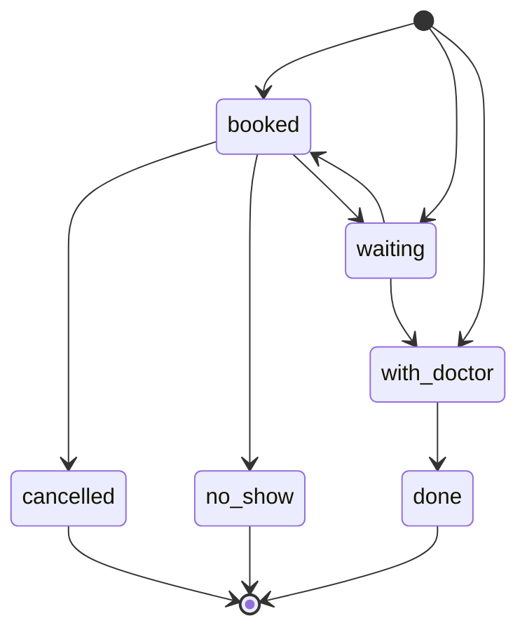
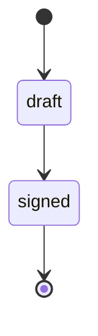
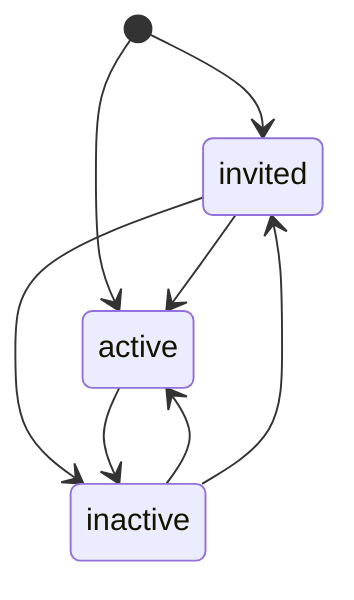
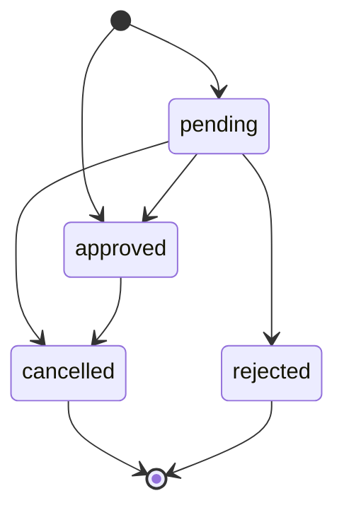
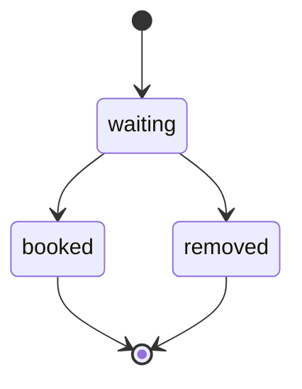
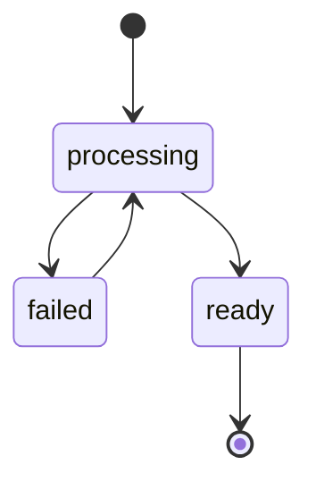

# States

Generated from `backend/app/shared/states.py`. Do not edit by hand.

## Visit (`visits.status`)

## Note (`notes.status`)

## Member (`members.status`)

## Leave (`leave_requests.status`)

## Waitlist (`waitlist.status`)

## Document (`documents.ai_status`)

